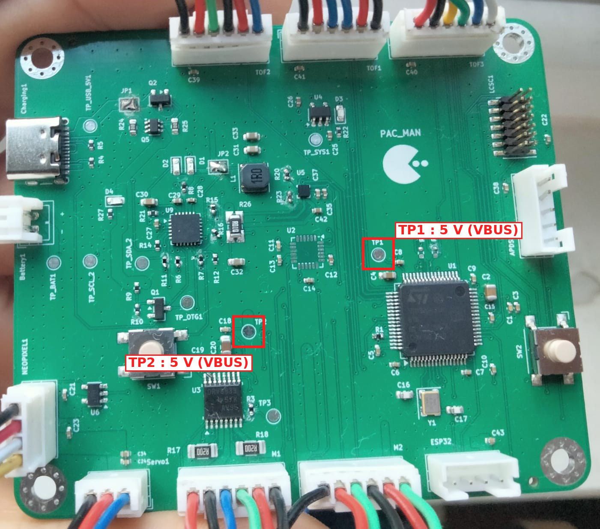
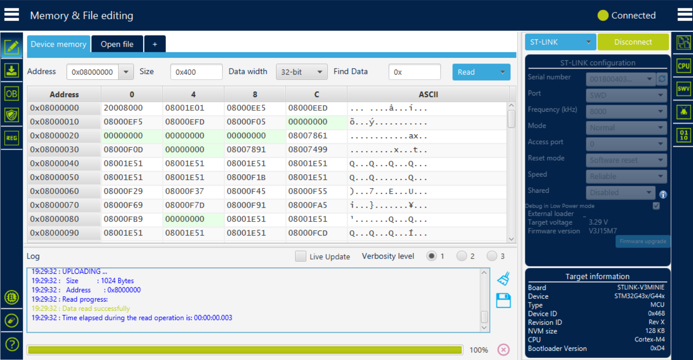
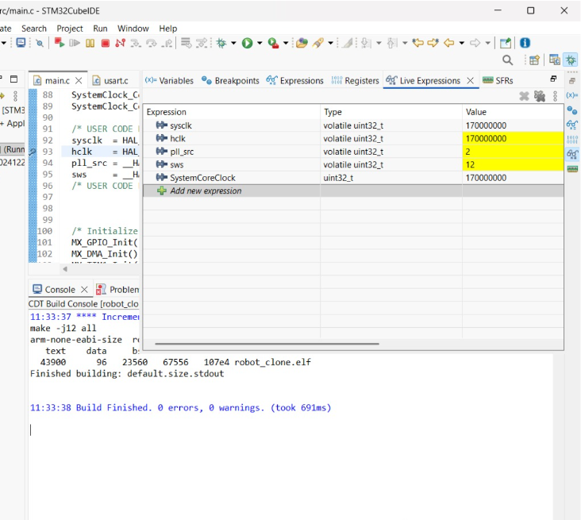
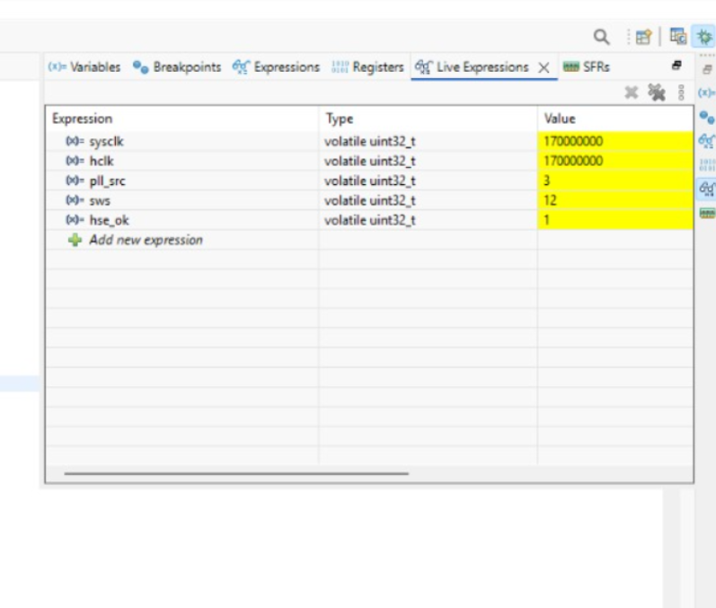
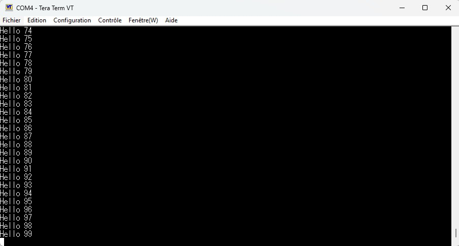
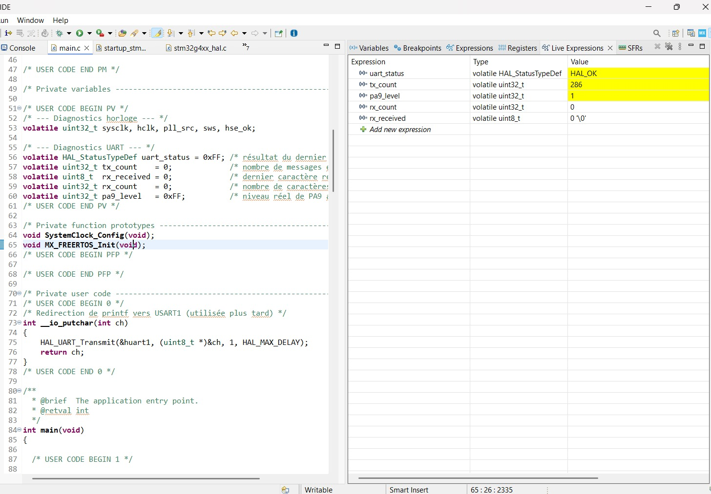
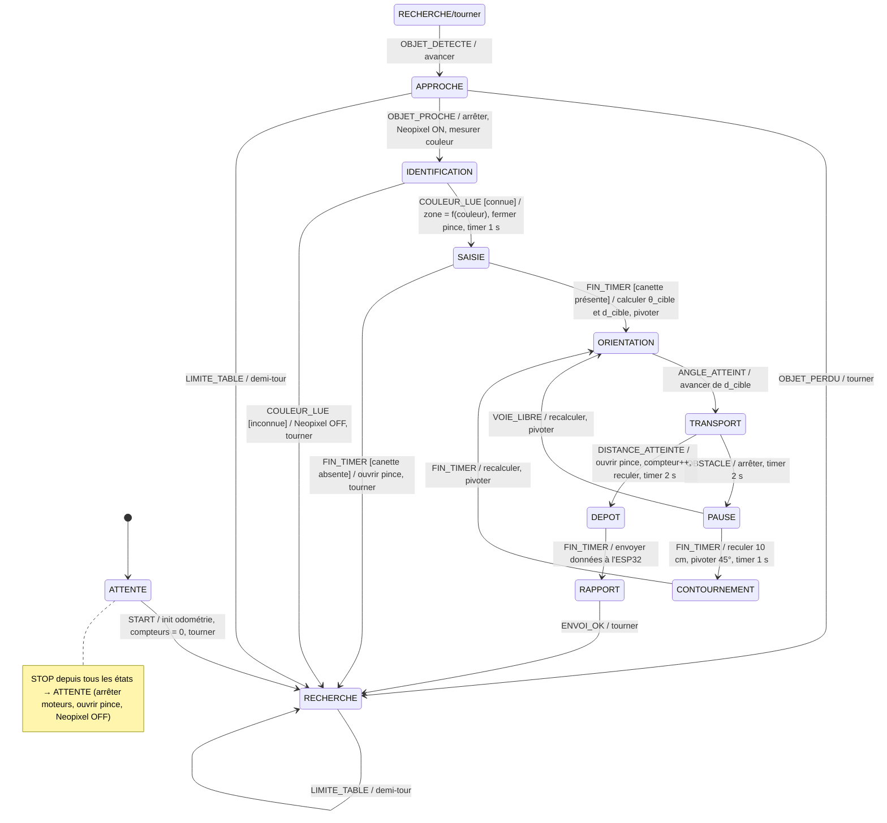

# 2627_ESE_PROJET_PAC-Man🤖🗑️
PAC-Man 

### Équipe
- **Yesmine Chakroun** (yasminechakroun31-sudo)
- **Wejdene Hazami**
- **Roua Jaouadi**

### Objectif
Concevoir un robot mobile qui repère, attrape, différencie et dépose des canettes en fonction de leur couleur.

### Timeline
- **Challenge:** 15 janvier 2027
- **Fin semestre:** 16 janvier 2027

---

## Bring-up du PCB

Cette section décrit tous les tests à réaliser pour valider la carte . Les tests se font **dans l'ordre** : chaque test suppose que les précédents sont réussis.

### Matériel nécessaire
- Multimètre et oscilloscope numérique
- Source d'alimentation de la carte : **[À COMPLÉTER : batterie LiPo 2S 7,4 V ou alimentation de labo]**
- STLINK-V3MINIE (programmation et débogage SWD)
- Logiciels : STM32CubeProgrammer, STM32CubeIDE

### Repérage des points de test


| Test point | Signal | Valeur attendue |
|---|---|---|
| TP1 | 3,3 V | 3,2 V – 3,4 V |
| TP2 | VBUS (5 V) | 4,75 V – 5,25 V |

> Remarque : TP2 (VBUS) n'est alimenté que lorsque le câble USB-C est branché sur le connecteur de charge (Charging1).

### Tests d'alimentation

#### Test 1 : Soudure des solder bridges JP1 et JP2
- **Objectif :** fermer les deux ponts de soudure qui relient les blocs d'alimentation entre eux :
  - **JP1** : relie l'USB-C (USB_5V) au rail VBUS (bloc de protection anti-retour Q2/Q5).
  - **JP2** : relie la sortie du chargeur BQ25896 au rail SYS, qui alimente le régulateur 3,3 V (U4).
- **Matériel :** fer à souder, étain, flux, multimètre.
- **Démarche :**
  1. Déposer un peu de flux sur les deux pastilles de JP1, puis les relier avec une goutte d'étain.
  2. Faire de même pour JP2.
  
  3. Au multimètre (mode continuité, carte **non alimentée**) : vérifier la continuité entre les deux pastilles de chaque pont.
  4. Vérifier qu'il n'y a **pas** de continuité entre chaque pont et la masse (GND).
- **Test réussi si :** continuité (bip) entre les deux pastilles de JP1 et de JP2, et aucune continuité avec GND.
- **Test échoué si :** pas de continuité (soudure froide ou trop peu d'étain), ou continuité avec GND (court-circuit).
- **Résultat :** ✅ Continuité vérifiée au multimètre entre les deux pastilles de JP1 et de JP2, aucune continuité avec GND .
- **Problèmes rencontrés et solutions :** aucun.
#### Test 2 : Tensions 3,3 V et 5 V
- **Objectif :** vérifier que la carte reçoit le 5 V de l'USB-C (VBUS) et que le régulateur U4 (AP2112K-3.3) fournit le 3,3 V.
- **Matériel :** multimètre (mode tension continue) et oscilloscope numérique.
- **Démarche :**
  1. Brancher un câble USB-C sur le connecteur de charge (Charging1).
  2. Relier la pointe noire (ou la masse de la sonde) à une masse de la carte, par exemple la broche GND du connecteur SWD.
  3. Mesurer la tension sur **TP2** (VBUS), puis sur **TP1** (3,3 V) : voir la photo des points de test.
- **Test réussi si :** TP2 entre 4,75 V et 5,25 V, et TP1 entre 3,2 V et 3,4 V, stables.
- **Test échoué si :** une tension est absente ou hors de ces plages.
- **Résultat :** ✅ TP2 (VBUS) = 5 V et TP1 = 3,3 V 
- **Problèmes rencontrés et solutions :** aucun.

#### Test 3 : Masse et LEDs d'alimentation
- **Objectif :** vérifier la continuité de la masse et l'allumage des LEDs d'alimentation.
- **Démarche :** vérifier la continuité GND entre **[À COMPLÉTER : points]**, puis mettre sous tension et observer les LEDs **[À COMPLÉTER : noms des LEDs]**.
- **Test réussi si :** continuité GND correcte et chaque LED d'alimentation s'allume.
- **Test échoué si :** une LED reste éteinte (vérifier son sens et sa résistance).
- **Résultat :** ✅ **[À COMPLÉTER : date]**

### Tests des composants de la carte

#### Test 4 : Connexion SWD au STM32
- **Objectif :** vérifier que le microcontrôleur est vivant et programmable par l'interface SWD.
- **Matériel :** STLINK-V3MINIE, STM32CubeProgrammer, fils de liaison.
- **Démarche :**
  1. Alimenter la carte (les LEDs d'alimentation doivent s'allumer).
  2. Relier le connecteur SWD de la carte au ST-Link : SWDIO, SWCLK, GND, T_VCC (3,3 V), NRST.
  3. Dans STM32CubeProgrammer : ST-LINK, port SWD, mode Normal → Connect.
  4. Lire la mémoire Flash à l'adresse 0x08000000.
- **Test réussi si :** « Connected », Device = STM32G43x/G44x, CPU Cortex-M4, Flash 128 KB, lecture mémoire réussie.
- **Test échoué si :** « No STM32 target found » / « Unable to get core ID ».




- **Problèmes rencontrés et solutions :** aucun.

#### Test 5 : Horloge interne HSI et PLL
- **Objectif :** vérifier que l'oscillateur interne HSI (16 MHz) fonctionne et que la PLL génère l'horloge système de 170 MHz.
- **Matériel :** STLINK-V3MINIE, STM32CubeIDE (mode Debug, vue Live Expressions).
- **Démarche :**
  1. Dans le .ioc : RCC → HSE = Disable ; Clock Configuration : PLL Source = HSI, SYSCLK = PLLCLK = 170 MHz.
  2. Dans main.c, après SystemClock_Config(), copier dans des variables globales `volatile` :
     `HAL_RCC_GetSysClockFreq()`, `HAL_RCC_GetHCLKFreq()`, `__HAL_RCC_GET_PLL_OSCSOURCE()` et `__HAL_RCC_GET_SYSCLK_SOURCE()`.
  3. Lancer le débogage et observer ces variables dans **Live Expressions**.
- **Test réussi si :** sysclk = hclk = SystemCoreClock = 170 000 000, pll_src = 2 (HSI), sws = 12 (PLL).
- **Test échoué si :** le programme reste bloqué dans `Error_Handler()`, ou les valeurs ne correspondent pas.




- **Problèmes rencontrés et solutions :** aucun.
#### Test 6 : Quartz externe HSE (Y1, 16 MHz)
- **Objectif :** vérifier que le quartz Y1 (16 MHz) et ses condensateurs de charge C16/C17 démarrent, et que la PLL peut générer 170 MHz à partir du HSE.
- **Matériel :** STLINK-V3MINIE, STM32CubeIDE (mode Debug, vue Live Expressions).
- **Démarche :**
  1. Dans le .ioc : RCC → HSE = Crystal/Ceramic Resonator ; Clock Configuration : Input frequency = 16 MHz, PLL Source = HSE, SYSCLK = PLLCLK = 170 MHz.
  2. Dans main.c, après SystemClock_Config(), copier dans des variables globales `volatile` :
     `HAL_RCC_GetSysClockFreq()`, `HAL_RCC_GetHCLKFreq()`, `__HAL_RCC_GET_PLL_OSCSOURCE()`, `__HAL_RCC_GET_SYSCLK_SOURCE()` et `__HAL_RCC_GET_FLAG(RCC_FLAG_HSERDY)`.
  3. Lancer le débogage et observer ces variables dans **Live Expressions**.
- **Test réussi si :** sysclk = hclk = 170 000 000, pll_src = 3 (HSE), sws = 12 (PLL), hse_ok = 1 (HSERDY).
- **Test échoué si :** le programme reste bloqué dans `Error_Handler()` (le quartz ne démarre pas), ou hse_ok = 0.



- **Problèmes rencontrés et solutions :** aucun.

#### Test 7 : LEDs (chenillard)
*À venir.*


#### Test 8 : USART1 (port COM virtuel du ST-Link)
- **Objectif :** vérifier l'émission et la réception de l'USART1 (PA9 = TX, PA10 = RX), relié au port COM virtuel du STLINK-V3MINIE par le connecteur SWD.
- **Matériel :** STLINK-V3MINIE, STM32CubeIDE (Live Expressions), Tera Term.
- **Démarche :**
  1. Dans le .ioc : USART1 en mode Asynchronous, 115 200 bauds, 8 bits, sans parité, 1 bit de stop.
  2. Le programme envoie « Hello N » en boucle et compte les messages envoyés (`tx_count`) et les caractères reçus (`rx_count`).
  3. Ouvrir Tera Term sur le port COM du ST-Link (ici COM4), à 115 200 bauds.
  4. Émission : vérifier que les messages s'affichent dans Tera Term.
  5. Réception : taper un caractère dans Tera Term et vérifier `rx_count` et `rx_received` dans Live Expressions.
- **Test réussi si :** les messages s'affichent lisiblement, `uart_status` = HAL_OK, `tx_count` augmente, et un caractère tapé incrémente `rx_count`.
- **Test échoué si :** rien ne s'affiche, des caractères illisibles apparaissent (horloge ou débit incorrect), ou `rx_count` reste à 0.
- **Résultat :**
  - Émission ✅ : « Hello N » reçu dans Tera Term, `uart_status` = HAL_OK, `tx_count` = 286, PA9 au repos à 1.
  - Réception : **[À COMPLÉTER]**




- **Problèmes rencontrés et solutions :** aucun.

### Tests des périphériques (un par un)

#### Test 9: APDS-9960 (couleur)
*À venir.*

#### Test 10: VL53L0X (distance)
*À venir.*

#### Test 11: MPU6050 (IMU)
*À venir.*

#### Test 12 : Moteurs + DRV8833
*À venir.*

#### Test 13 : Encodeurs
*À venir.*

#### Test 14 : Servo de la pince
*À venir.*

#### Test 15 : Liaison UART avec l'ESP32
*À venir.*

### Bilan du bring-up

| Test | Résultat | Date |
|---|---|---|
| 1. Solder bridges JP1 et JP2 | ✅ | |
| 2. Tension 3,3 V | ✅ | |
| 3. Masse et LEDs d'alimentation | ✅ | |
| 4. Connexion SWD | ✅ | 17/11/2026 |
| 5. HSI | ⏳ | |
| 6. LEDs | ⏳ | |
| 7. HSE | ⏳ | |
| 8. USART | ⏳ | |
| 9 à 15. Périphériques | ⏳ | |

---

## Architecture logicielle

### Machine à états du robot

Capteurs utilisés : 3 ToF VL53L0X (avant, gauche, droite), 1 APDS-9960 (couleur et proximité, dans la pince) et les encodeurs des 2 moteurs (odométrie). Le robot n'a pas d'IMU.



### Événements

| Événement | Source | Condition |
|---|---|---|
| `START`, `STOP` | boutons | appui |
| `OBJET_DETECTE` | ToF avant | `d_avant < D_DETECT` (≈ 50 cm) |
| `OBJET_PERDU` | ToF avant | plus d'objet devant |
| `OBJET_PROCHE` | ToF avant | `d_avant ≤ D_GRAB` (≈ 5 cm) |
| `COULEUR_LUE` | APDS-9960 | mesure de couleur terminée |
| `FIN_TIMER` | timer | délai écoulé |
| `ANGLE_ATTEINT`, `DISTANCE_ATTEINTE` | encodeurs | rotation ou déplacement terminé |
| `OBSTACLE`, `VOIE_LIBRE` | ToF (avant, gauche, droite) | un robot apparaît, puis s'en va |
| `LIMITE_TABLE` | odométrie | position hors de la zone autorisée |
| `ENVOI_OK` | UART3 (ESP32) | données envoyées |

### Choix de la zone de dépôt

La position `(x, y, θ)` du robot est calculée par **odométrie**, avec les encodeurs uniquement (`E` = écart entre les roues) :

```
d  = (dD + dG) / 2
Δθ = (dD − dG) / E
x += d·cos(θ)   y += d·sin(θ)   θ += Δθ
```

Chaque couleur correspond à une zone de coordonnées connues `(x_z, y_z)`. Après la saisie, le robot calcule :

```
θ_cible = atan2(y_z − y, x_z − x)
d_cible = √((x_z − x)² + (y_z − y)²)
```

Le bord de la table est une **limite virtuelle** calculée par odométrie, avec une marge de sécurité d'environ 10 cm. Sans IMU, l'erreur de position augmente avec les patinages et les chocs : cette marge est à valider sur la vraie table.

### Reset

- **Logiciel :** l'événement `STOP` ramène le robot dans `ATTENTE` depuis n'importe quel état. Les variables sont réinitialisées au prochain `START`.
- **Matériel :** le bouton SW2 (NRST) redémarre le STM32, qui repart de `ATTENTE`.